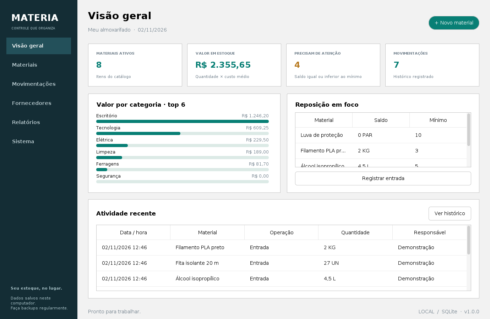

# Materia

Aplicativo Java desktop para cadastrar materiais e controlar um almoxarifado local. Interface em português, navegação lateral, painel de estoque, tema claro/escuro e persistência SQLite.



## Recursos implementados

- Materiais: código único, nome, categoria, unidade, localização, código de barras único opcional, fornecedor, custo, preço de referência, mínimo, saldo e observações.
- Fornecedores: cadastro, edição, documento opcional, contato, telefone, e-mail, endereço, observações e arquivamento.
- Entradas com custo médio ponderado; saídas com bloqueio de saldo negativo; ajuste pelo saldo final contado.
- Histórico permanente com responsável, motivo, documento, quantidade, custo e saldo resultante. Correções de saldo são novas movimentações.
- Arquivamento preserva o histórico e exige estoque zerado. A unidade fica bloqueada depois da primeira movimentação.
- Busca sem distinção de acentos, filtros por categoria/situação, tabelas ordenáveis e atalhos.
- Painel com valor em estoque, alertas, atividade recente e gráfico por categoria.
- Exportação CSV de materiais, fornecedores e movimentações; importação transacional de novos materiais com modelo e confirmação prévia.
- Relatório de inventário, reposição e movimentações por período; CSV, HTML imprimível e impressão de tabela.
- Backup manual, cópia diária na abertura (retenção de 14 dias com abertura) e restauração com validação e cópia de segurança anterior.
- Dados fictícios opcionais, carregados somente por uma ação explícita em uma base sem materiais.

## Abrir a versão Windows

Extraia **todo** o ZIP `Materia-1.0.0-Windows-x64.zip` e execute `Materia.exe`. Mantenha `app` e `runtime` ao lado do executável. A distribuição portátil inclui Java para Windows x64; não requer Java instalado nem internet durante o uso.

Os dados ficam em `%LOCALAPPDATA%\Materia`, separados do programa. O aplicativo não precisa de privilégios de administrador. No primeiro uso a base começa vazia; em **Sistema** é possível carregar exemplos fictícios.

O iniciador entregue é um PE Windows x64 compilado de `native/launcher.c`, que abre `runtime/bin/javaw.exe` com `app/materia.jar`. O programa e todas as regras são Java. O script de build para Windows usa o iniciador padrão do `jpackage`; ambos abrem a mesma aplicação.

## Desenvolver no IntelliJ IDEA

Pré-requisitos: **JDK 17 ou superior** e **Apache Maven 3.9+** (ou o Maven incluído no IntelliJ). Abra a pasta que contém `pom.xml` e selecione o JDK do projeto. Aguarde a importação das dependências e execute `br.com.materia.App` em `src/main/java`.

No terminal PowerShell, com Maven e JDK no PATH:

```powershell
mvn -B verify
java "-Dfile.encoding=UTF-8" -jar target/materia-1.0.0.jar
```

Para gerar uma versão Windows com Java incluído, execute **no Windows**:

```powershell
powershell -ExecutionPolicy Bypass -File .\scripts\gerar-windows.ps1
```

Saídas: `dist\Materia\Materia.exe` e `dist\Materia-1.0.0-Windows-x64.zip`. O `jpackage --type app-image` não precisa de WiX. O empacotamento é específico da plataforma; rodar esse comando em Linux não produz um `.exe` Windows.

Para executar uma base isolada durante desenvolvimento:

```powershell
java -jar target/materia-1.0.0.jar --data-dir .\dados-teste
```

Em Linux, o diretório padrão é `~/.local/share/Materia`.

## Regras dos valores

Dinheiro é armazenado em **centavos inteiros** e quantidades em **milésimos inteiros**, sem `double` nas regras de estoque. Campos aceitam vírgula ou ponto decimal, sem separador de milhares. Dinheiro: até duas casas. Quantidade: até três casas, em qualquer unidade. Limite por valor monetário: R$ 999.999.999,99. Limite por quantidade: 999.999.999 unidades.

Entrada calcula `(saldo_anterior × custo_anterior + quantidade × custo_compra) / novo_saldo`, arredondando o custo unitário para centavos com HALF_UP. Saídas e ajustes mantêm o custo médio atual. Alterar manualmente o custo no cadastro reavalia o estoque atual; não reescreve custos históricos. O preço cadastrado é informativo, sem sistema de vendas.

**Estoque baixo:** saldo positivo menor ou igual ao mínimo. **Sem estoque:** saldo zero. O painel e o relatório de reposição incluem ambos. O inventário sempre mostra o saldo atual; o período filtra somente movimentações. Datas/horas usam o relógio local do computador.

## CSV

Em **Materiais > Mais ações**, baixe o modelo. Formato: UTF-8, separador `;`, com campos entre aspas quando necessário. Cabeçalho exato:

```text
codigo;nome;categoria;unidade;localizacao;codigo_barras;custo;preco;estoque_minimo;estoque_inicial;observacoes
```

Importação cria novos materiais, não atualiza registros. Até 10.000 materiais / 5 MB por arquivo. Conflitos de código ou código de barras cancelam o lote inteiro, inclusive saldos iniciais. O fornecedor é vinculado pela tela após importar. O CSV exportado é um relatório com colunas diferentes, não o modelo de importação. Campos com aparência de fórmulas recebem apóstrofo na exportação para planilhas.

## Dados e backup

Schema v1 criado automaticamente, com chaves estrangeiras, índices e restrições. Cada movimentação atualiza saldo e histórico na mesma transação. Uma trava de arquivo impede duas instâncias do aplicativo na mesma pasta. Mantenha a pasta de dados em disco local; não use uma base aberta diretamente em pasta de rede ou sincronizada.

Backups usam `VACUUM INTO`. Na restauração, o aplicativo valida integridade SQLite, versão, tabelas, vínculos e correspondência entre saldo e soma dos lançamentos. Preserva um backup `pre-restauracao-*` antes de trocar o banco. A restauração altera cadastros e movimentações; as preferências locais são mantidas.

## Estrutura

```text
src/main/java/br/com/materia/
  App.java             inicialização, trava da instância e logs
  domain/              modelos e conversão exata de valores
  infra/               SQLite, CSV, relatórios e preferências
  service/             validação, transações e regras de estoque
  ui/                  telas Swing e formulários
src/test/java/         testes de regras, persistência, backup e interface
native/               iniciador Windows em C e ícone
scripts/              comandos PowerShell
```

## Verificação

`mvn verify` executa os testes automatizados. O teste de interface exige desktop e a variável `MATERIA_UI_TEST=1`; em Linux pode ser executado com `xvfb-run -a env MATERIA_UI_TEST=1 mvn -Dtest=UiSmokeTest test`. Capturas geradas para inspeção ficam em `target/ui-qa`.

O workflow incluído executa verificação Linux e empacotamento Windows no GitHub Actions. Consulte [Actions](https://github.com/eliasramineli-sys/Materia1.0/actions) para o estado atual das execuções. Ao concluir a tarefa Windows, o ZIP com o aplicativo fica disponível nos artefatos da execução. Consulte `docs/VALIDACAO.md` para a verificação local desta entrega.

## Escopo e licença

Versão local para uma pessoa por base, sem autenticação, sincronização, permissões, emissão fiscal ou integrações externas. Não é um serviço público nem um sistema contábil. O documento do fornecedor não consulta nem valida cadastro na Receita. O executável não possui assinatura digital comercial.

A licença do código autoral fica pendente da escolha do proprietário. As licenças dos componentes de terceiros estão em `THIRD-PARTY-NOTICES.md`, nos JARs e no runtime distribuído.

Referências oficiais: [FlatLaf](https://github.com/JFormDesigner/FlatLaf), [SQLite JDBC](https://github.com/xerial/sqlite-jdbc), [Eclipse Temurin](https://adoptium.net/), [jpackage](https://docs.oracle.com/en/java/javase/17/docs/specs/man/jpackage.html).
